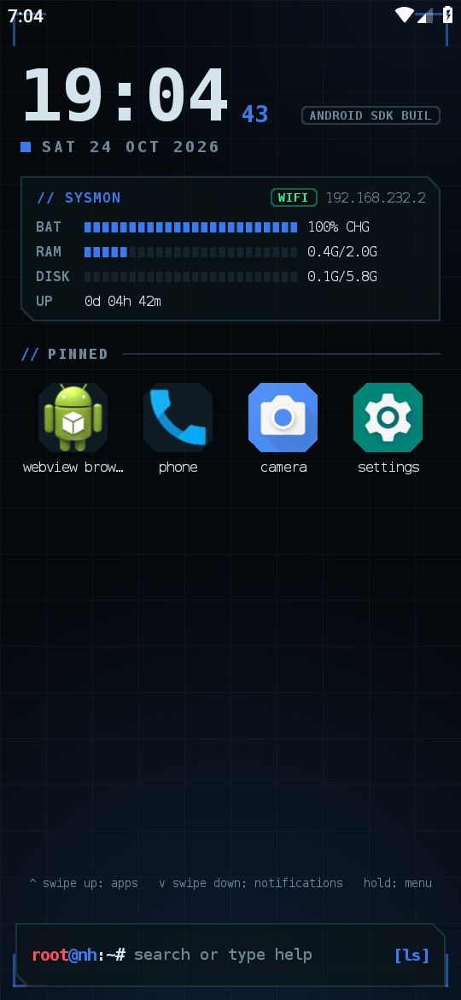
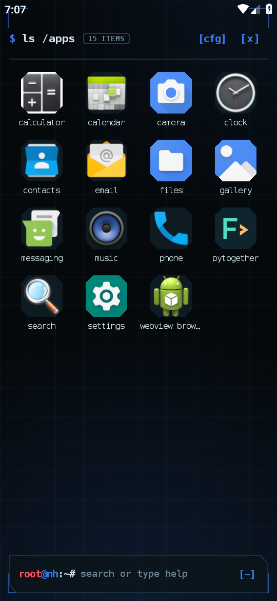
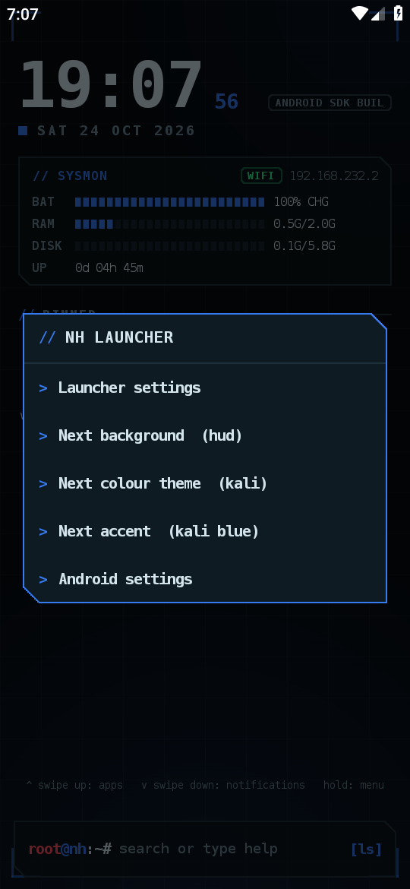
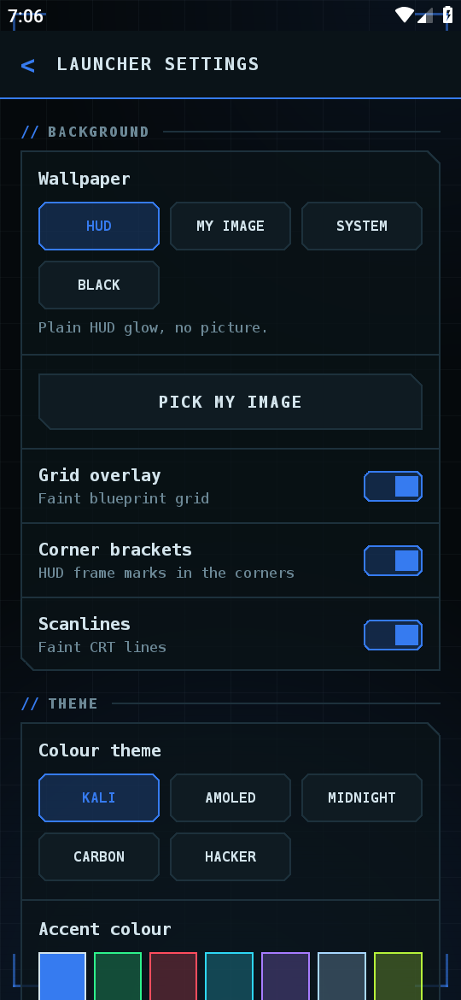
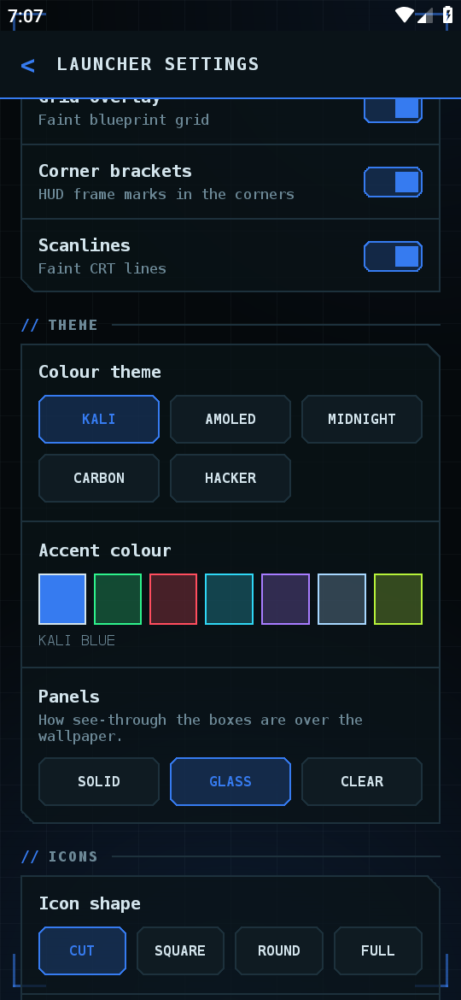
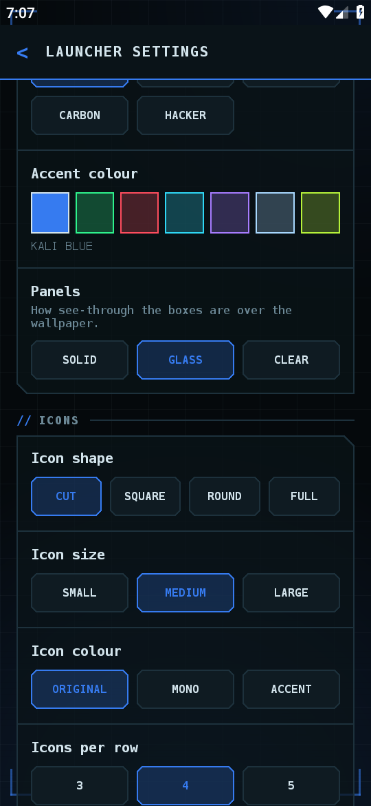
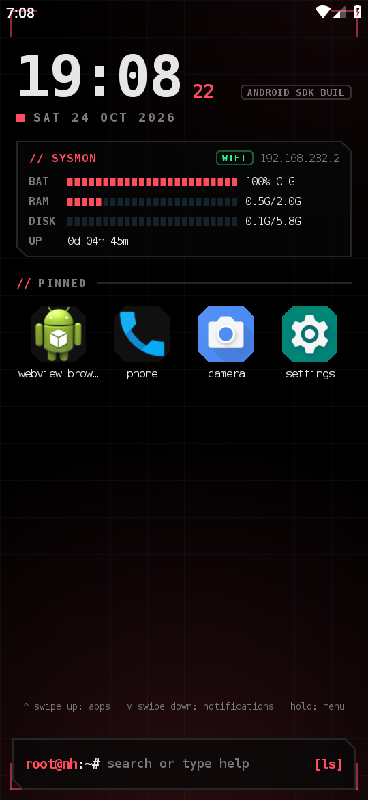
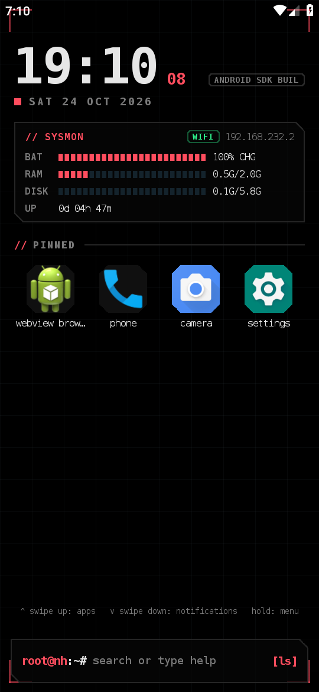

# NH Launcher

A small, offline Android home-screen launcher with a black / blue "hacker HUD" look, made for phones that run Kali NetHunter (or for anyone who likes the style). It is a normal launcher: it replaces your home screen and app drawer, nothing more.

> **Independent project.** NH Launcher is not affiliated with, endorsed by or sponsored by OffSec, Kali Linux or Kali NetHunter. *Kali* and *NetHunter* are trademarks of their respective owners. This repo and its release APK contain **no** Kali / NetHunter logos or artwork.

| Home | App drawer | Long-press menu |
|---|---|---|
|  |  |  |

| Settings: background | Settings: theme | Settings: icons and home |
|---|---|---|
|  |  |  |

| AMOLED + crimson | Black background |
|---|---|
|  |  |

*(Screenshots are from an Android 9 emulator, so the model tag reads "ANDROID SDK BUIL".)*

## Features

- **Home screen:** big clock (12/24 h, optional seconds), date, a system monitor (battery, RAM, storage, network, uptime), pinned apps, and a `root@nh:~#` search/command bar.
- **App drawer:** swipe up, instant search, long-press to pin, hide or open app info. Hidden apps stay installed.
- **Background:** HUD glow, your own image, the system wallpaper, or plain black. Dim level, fit/fill, position, and a "set as phone wallpaper" button. Optional grid, corner brackets and scanlines.
- **Themes:** Kali, AMOLED, Midnight, Carbon and Hacker colour themes, 7 accent colours, solid / glass / clear panels.
- **Icons:** cut, square, round or full shape; small / medium / large; original, mono or accent colour; 3-5 icons per row; app labels on/off.
- **Gestures:** swipe up = drawer, swipe down = notifications, long-press = menu (each can be switched off). Optional hidden status bar.
- **Command bar:** type `help` for commands such as `bg` (next background), `palette` (next theme) and app names.
- **Reset** button for all look-and-feel settings.

## Privacy

No analytics, no accounts, no ads. The app does **not** request the `INTERNET` permission, so it cannot send data off your phone. Permissions it does use:

| Permission | Why |
|---|---|
| `EXPAND_STATUS_BAR` | swipe-down to open notifications |
| `ACCESS_NETWORK_STATE` | show Wi-Fi / mobile status and IP in the system monitor |
| `SET_WALLPAPER` | only for the "Set as phone wallpaper" button |

Your chosen background image is copied into the app's private storage; nothing leaves the device.

## Install

1. Download `NHLauncher-0.1.1.apk` from the [Releases](../../releases) page (pre-release).
2. Allow installing from your browser/file manager when Android asks, then install.
3. Press Home and choose **NH Launcher**, or open the app and tap *Choose default launcher*.

Requires Android 7.0 (API 24) or newer. Tested on an Android 9 emulator and on a real phone; feedback from other devices is welcome.

The release APK is signed with the author's key. If you build it yourself it will be signed with *your* key (or unsigned), so it cannot update the official APK and vice-versa.

## Build

```sh
git clone https://github.com/zinmyo19/nh-launcher.git
cd nh-launcher
./gradlew assembleRelease          # needs JDK 17 and the Android SDK (platform 34)
```

To sign the release build, copy `signing.properties.example` to `signing.properties` (git-ignored) and fill it in, or set `NH_SIGNING_PROPS=/path/to/file`. The output is `app/build/outputs/apk/release/app-release.apk`.

## Licence

GPL-3.0-or-later. See [LICENSE](LICENSE) and [NOTICE](NOTICE) (third-party components and trademark notes).
